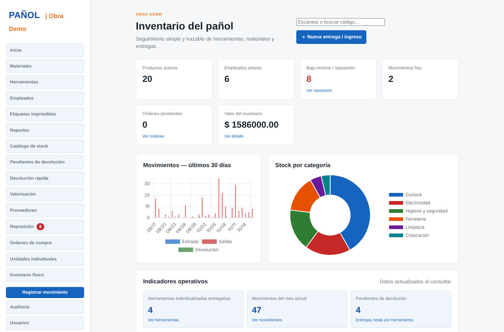
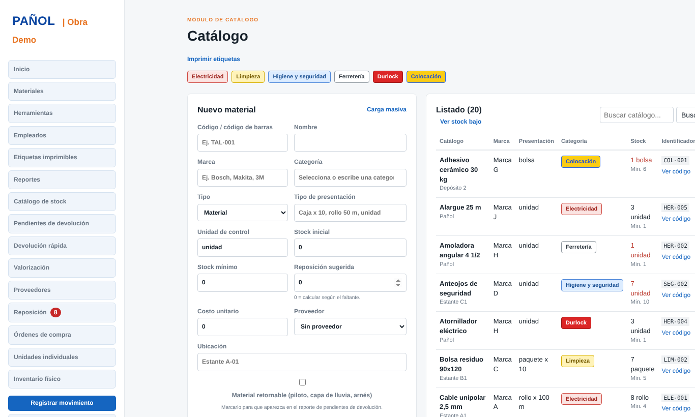
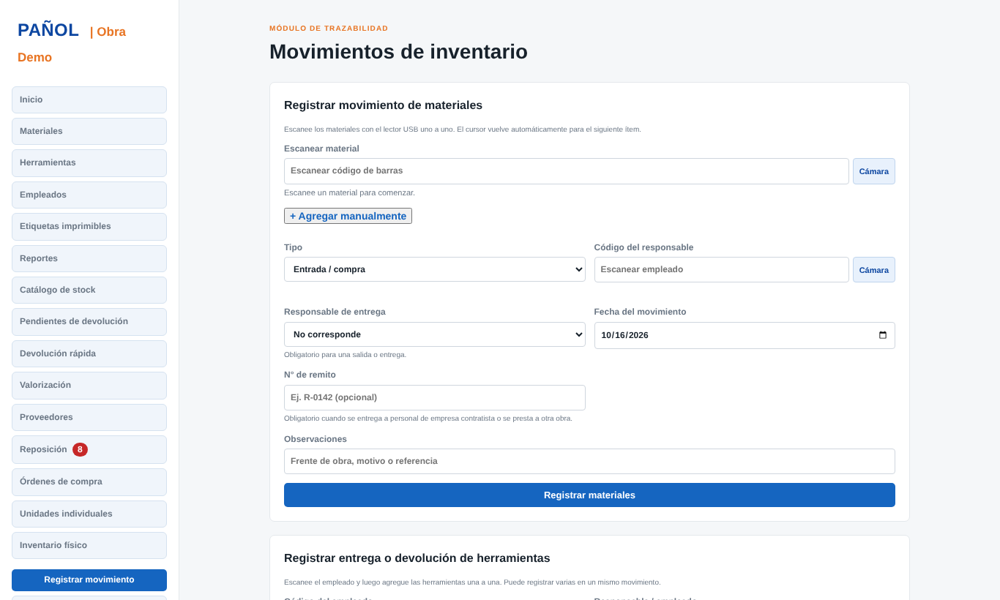
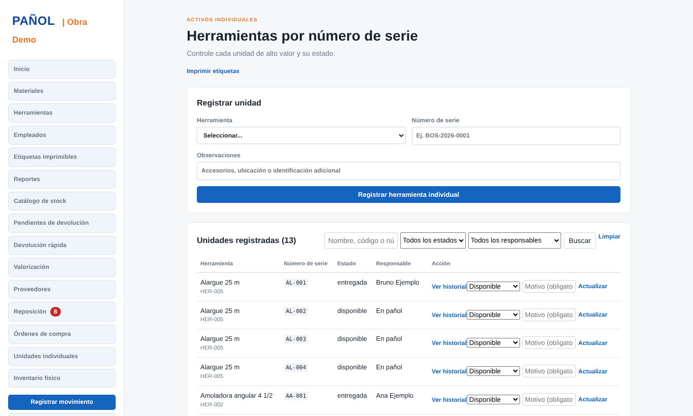
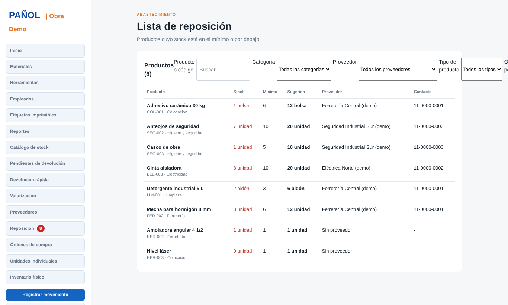

# Inventario Pañol

Aplicación web en Python para controlar los **materiales y herramientas de un pañol de obra**: quién retiró qué, cuándo, qué falta reponer y qué herramientas siguen sin devolverse.

Desarrollada por **Arnulfo José Azuaje Roa** para el pañol de una obra en Buenos Aires. Los datos de este repositorio son **ficticios**.



## Qué resuelve

- Saber en todo momento **qué stock hay** y qué está **por debajo del mínimo**.
- Registrar **entradas, entregas, devoluciones y ajustes** con trazabilidad por empleado.
- Controlar cada **herramienta por número de serie**: disponible, entregada, en reparación, dañada, perdida o dada de baja.
- Detectar **herramientas pendientes de devolución**.
- Generar **comprobantes, etiquetas con código de barras y QR, y reportes** listos para imprimir.

## Tecnologías

Python 3 · Flask · SQLite · Waitress · ReportLab (PDF y códigos) · openpyxl (Excel) · python-barcode · pytest · HTML/CSS/JavaScript

## Capturas

| Materiales | Movimientos |
|---|---|
|  |  |

| Herramientas por número de serie | Reposición |
|---|---|
|  |  |

## Funcionalidades

**Inventario**
- Productos con código, categoría, unidad, presentación, ubicación, marca, proveedor y stock mínimo; clasificados como materiales o herramientas.
- Identificación por categoría (Electricidad, Limpieza, Higiene y seguridad, Ferretería, Durlock, Colocación).
- Carga masiva por CSV con plantilla y validación transaccional (hasta 10.000 filas; si hay errores no se guarda nada).
- Listados con filtros y paginación segura.

**Movimientos y herramientas**
- Entradas, entregas, devoluciones y ajustes, **de varios ítems por operación**, con validación para no entregar más de lo disponible.
- Reversión controlada con motivo obligatorio: genera un movimiento compensatorio y nunca borra el original.
- Herramientas individualizadas con historial de estados y responsable actual.
- Devolución rápida y reporte de pendientes agrupado por empleado.
- Escaneo con lector USB o con la cámara del teléfono (Code 128, QR, EAN, UPC).

**Compras y reposición**
- Proveedores y lista de reposición con cantidad sugerida.
- Órdenes de compra con estados (borrador, solicitada, parcial, recibida, cancelada) y recepción parcial que actualiza el stock.
- Valorización del inventario por costo unitario.

**Documentos y reportes**
- Reportes en PDF, Excel y CSV respetando los filtros.
- Comprobantes PDF de cada movimiento, con espacio para firmas.
- Etiquetas imprimibles en lote con código de barras y QR.

**Seguridad y control**
- Usuarios con roles: `admin`, `supervisor`, `pañolero` y `consulta`.
- Auditoría de altas, modificaciones, movimientos, reversiones y backups.
- Contraseñas con hash, protección CSRF, cookies `HttpOnly` y bloqueo temporal tras 5 intentos fallidos de acceso.
- Inventario físico: conteo, diferencias, aprobación y ajustes auditados.
- Copias de seguridad SQLite consistentes, con retención configurable.

## Puesta en marcha

```bash
python -m venv .venv
# Windows:  .venv\Scripts\activate
# Linux/Mac: source .venv/bin/activate
pip install -r requirements.txt

python seed_demo.py --reset   # crea una base con datos FICTICIOS de ejemplo
python serve.py               # servidor en http://127.0.0.1:8000
```

Usuario de la base de ejemplo: `admin` / `Demo-Panol-2026` (solo para la demo).

También se puede iniciar con `python app.py` (servidor de desarrollo de Flask, `http://127.0.0.1:5000`).

> Los gráficos del inicio cargan Chart.js desde un CDN, por lo que necesitan conexión a Internet.

### Instalación real (sin datos de ejemplo)

No hay ninguna contraseña por defecto. En el primer arranque se crea el usuario administrador así:

- Si definió `PANOL_ADMIN_PASSWORD` (mínimo 8 caracteres), se usa esa.
- Si no, se **genera una contraseña aleatoria** y se muestra una sola vez en la consola. Guárdela y cámbiela.

```powershell
$env:PANOL_SECRET_KEY="una-clave-secreta-larga-de-32-caracteres-o-mas"
$env:PANOL_ADMIN_USER="administrador"
$env:PANOL_ADMIN_PASSWORD="una-contraseña-segura"
python serve.py
```

Variables de entorno disponibles:

| Variable | Para qué sirve | Por defecto |
|---|---|---|
| `PANOL_HOST` | Interfaz de escucha de `serve.py` | `127.0.0.1` |
| `PANOL_PORT` | Puerto (1–65535) | `8000` |
| `PANOL_THREADS` | Hilos de Waitress (1–1000) | `4` |
| `PANOL_SECRET_KEY` | Clave de sesión (mínimo 32 caracteres) | se genera y guarda en `data/secret.key` |
| `PANOL_ADMIN_USER` / `PANOL_ADMIN_PASSWORD` | Primer usuario administrador | `admin` / aleatoria |
| `PANOL_HTTPS` | `true` marca la cookie de sesión como segura | desactivado |
| `PANOL_BACKUP_DIR` / `PANOL_BACKUP_RETENTION` | Carpeta y cantidad de copias | `data/backups` / 30 |

No use `PANOL_HOST=0.0.0.0` salvo que comprenda que expone el servicio en toda la red. Waitress no ofrece HTTPS: fuera de una red de confianza, use un proxy inverso con TLS.

## Pruebas

```bash
pytest
```

41 pruebas automáticas sobre acceso y roles, productos, movimientos, herramientas individualizadas, órdenes de compra, reportes, comprobantes, backups y auditoría.

## Automatizaciones (Windows)

La carpeta `scripts/` incluye tareas que se registran en el Programador de tareas de Windows (ejecutar el `.ps1` correspondiente desde PowerShell):

| Script | Qué hace |
|---|---|
| `registrar_tarea_backup.ps1` | Copia de seguridad diaria (23:00) |
| `registrar_tarea_alerta.ps1` | Alerta de stock mínimo, diaria (08:00) y al iniciar sesión, con notificación de Windows y correo |
| `registrar_tarea_devoluciones.ps1` | Aviso diario (08:30) de herramientas y materiales retornables con más de N días sin devolver |
| `registrar_tarea_ordenes.ps1` | Diaria (07:00): crea una orden de compra borrador por proveedor para lo que está bajo mínimo y no tiene una orden activa |
| `registrar_tarea_vacuum.ps1` | Mantenimiento semanal (domingo, 02:00) de la base SQLite |

Para los avisos por correo, copie `data/alerta_config.example.ini` como `data/alerta_config.ini` y complete sus datos. Ese archivo está en `.gitignore` y no debe subirse. Los scripts leen la base de `data/panol.db`; con `PANOL_HOME` se puede indicar otra carpeta.

## Estructura

```
app.py                 Aplicación Flask (rutas, reglas de negocio, reportes)
serve.py               Arranque de producción con Waitress
seed_demo.py           Datos ficticios de ejemplo
templates/ static/     Interfaz
scripts/               Tareas automáticas (backup, alertas, órdenes, mantenimiento)
tests/                 Pruebas con pytest
data/                  Base SQLite, copias y configuración (no se sube al repositorio)
```

## Limitaciones

- Pensado para una instalación local en un pañol, con SQLite; no está diseñado para muchos usuarios simultáneos.
- La cámara del teléfono requiere HTTPS o `localhost` por una restricción de los navegadores.
- El archivo `app.py` concentra toda la lógica; dividirlo en módulos sería la siguiente mejora.
